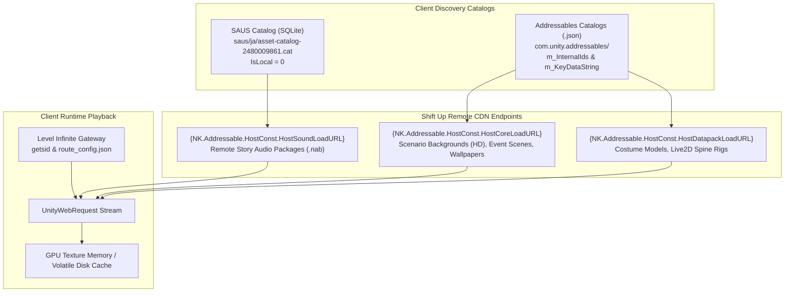

# On-demand CDN delivery and remote asset registry: Maiden & Miranda

Target: `Goddess of Victory: NIKKE` (PC Client Build 578825, Version 153.6.10)  
Entity: Maiden (`c181`), Maiden: Ice Rose (`c183`), and Miranda (`c032`)  
Workspace: `workspace/nikke-maiden/`

---

## 1. Remote delivery architecture

The PC client splits asset storage between local content-defined chunk containers (`store.cdb`) and remote on-demand Addressables CDN endpoints.

### Dynamic endpoint resolution
Remote Addressables bundles and SAUS audio packages are resolved using runtime parameter prefixes:
- `{NK.Addressable.HostConst.HostSoundLoadURL}`: Remote story dialogue voice packages (`.nab`).
- `{NK.Addressable.HostConst.HostCoreLoadURL}`: High-definition scenario backgrounds (`scenariobackground(hd)`), animated event scenes (`spineeventscenesgroup(hd)`), and live wallpaper prefabs (`livewallpaperprefabs`).
- `{NK.Addressable.HostConst.HostDatapackLoadURL}`: Seasonal costumes, Live2D Spine standing puppets, and overworld field models.

### Authentication and access control
Direct requests to these CDN endpoints require active session tokens issued by the Level Infinite gateway (`https://aws-na-dr.intlgame.com/v2/dr/getsid`). Raw unauthenticated HTTP requests return HTTP 403 Forbidden.

---

## 2. Remote story dialogue voice packages (SAUS JA)

Story dialogue tracks voiced by Horie Yui (堀江由衣) are cataloged in the SAUS SQLite database (`saus/ja/asset-catalog-2480009861.cat`). In the client database schema, each asset record in `AssetEntity` links via `FileId` to `FileInfoEntity`. All items below have flag `IsLocal = 0`, confirming they are remote on-demand CDN packages rather than local pre-installed packages.

### 2.1 Maiden narrative scene dialogue packages (12 packages)

In the NIKKE client architecture, `.nab` containers house entire scene dialogue sets. The `_181` suffix on script audio keys indicates dialogue spoken by Maiden within that chapter or event script.

| Context | Script audio key | Container path | File ID | Size (bytes) | SHA-256 container hash |
| :--- | :--- | :--- | :--- | :--- | :--- |
| **Main Scenario Ch 13 Ep 8** | `d_main_13_08_e_181` | `ab/98901a3b01636c5fca6e9ea9b8d97f31c31fe8047bfa274ceb875c7932b5ae6d.nab` | 991596696 | 5,443,761 | `254BFD621FD9E6B6B58CDC7BE704045B4231239B27D435252CE0D521B245BF7C` |
| **Main Scenario Ch 24 After Ep 6** | `d_main_24af_06_181` | `ab/a0dee572dcb7404d05a81990fac2dbbc2d96de2d34b9862bc1a30336cb73b08a.nab` | 1927667360 | 5,781,217 | `B9023BF25897F6E87E06011ED8FC4FC0DDEE241428D45831CF1EC2D5BABB7CB6` |
| **Main Scenario Ch 26 After Ep 1** | `d_main_26af_01_181` | `ab/da7f01f7dd22e11401badd73ca8a66512a8f3feb59502acb344e3766490b451b.nab` | -150896678 | 5,501,164 | `0566A76CCCECEA0518487D12B69F92B3ADD08FD34C07BD2AE77A3473C25C35BD` |
| **Main Scenario Ch 27 Ep 7** | `d_main_27_07_181` | `ab/5f0e8e5e569865c186944d7bf9a5d36cef8f01fe2d99835256f88f716e56c4c7.nab` | 1586368095 | 5,245,465 | `29F57E6C07B8CA1616D202F148B1D34D73D6D39DCC2890FC19DFED8C89504F1C` |
| **Main Scenario Ch 31 Ep 6** | `d_main_31_06_181` | `ab/facd4cad3163386d12d6682efa8665aae83ddc4e64e7e298004e121f18b85e4f.nab` | -1387475462 | 2,233,842 | `1F56F8EDED53CF15CB42C3FAB7A53A4D2959E9D7E7F9957EA444156BBAB7EC86` |
| **Main Scenario Ch 31 Ep 8** | `d_main_31_08_181` | `ab/92f3a2307d643180e8fd596585f4219534f4e8a45a08920a5e327df85607b946.nab` | 815985554 | 3,176,379 | `DCD431BCBE8B2C070CC1E8E524D77D735279CEEB1912F5A1DD393D398BF06EDD` |
| **Beauty Full Shot Part 1 Ep 2** | `event_beautyfullshot1_02_s_181` | `ab/45f4dcdf3c2bd388649fd2de38362b3465a3c53a7640914360fef06724abacd4.nab` | -539167675 | 5,349,057 | `C9D476D6BB13FEA86DE7964674FF62F9661AC766C51C9EC50FD85CAF7D5585CB` |
| **Golden Coin Rush Part 1 Ep 3** | `event_goldencoinrush1_03_s_181` | `ab/440dd1163d1e6baa29b0e4b9ab99685eef08e6d178ebc83ec3f7c824bddb2f53.nab` | 382799172 | 10,012,921 | `ED0BE49083D3558BB2BA1B45CEDB68BF615693B1AB5E9DB04AFECE1A83A156A9` |
| **Red Ash Part 1 Ep 6** | `event_redash1_06_e_181` | `ab/932415c25d990317bbf7f6e66c09c1e1e61f9de8c2ecbb6b990fe4a97abbc879.nab` | -1038801773 | 3,696,183 | `868872F83900C22EBD3C9940403CF98F2D72FCAD42A33A163F396B62DC21F7A1` |
| **Red Ash Part 2 Ep 6** | `event_redash2_06_e_181` | `ab/8d996e872d3cb778d708e5705b71c66be9926e946a5706df305a5a73ae673eeb.nab` | -2022794867 | 4,883,485 | `2B25662BFE7D84BDEA82F3C0ADE375047935B29D2B07A37D8D02AC0836822DD1` |
| **Sea, You, Again Part 1 Intermission 1** | `event_seayouagain1_intermission_01_181` | `ab/4b9e5a008255178c3fc078fb04350d5fe8b1eafae661b492784339476d8fd071.nab` | 5938763 | 4,967,400 | `814E92314FF1EB3FB5FA92EDB546FD4E2B6F00B1FFEC45286214E8DBC12D5524` |
| **Sea, You, Again Part 2 Ep 6** | `event_seayouagain2_06_e_181` | `ab/513aba942bc1d05d300d078d17156958ba5d61128ab5b955dd9d53d10c8a51d0.nab` | -1799734703 | 4,068,184 | `3EC37D96C1E5362B32BC01041D5D6E257A51CCD5F6908A625BAE41BF7EB7A918` |

### 2.2 Maiden direct character audio packages (4 packages)

These four packages contain direct Maiden voice tracks cataloged in SAUS JA with `IsLocal = 0`:

| Container path | File ID | Size (bytes) | Status on local client | Content description |
| :--- | :--- | :--- | :--- | :--- |
| `ab/813b04cf4c3c97cfdcc8d9d0e699383ee37e8385797ff71a03b1e7e5a890328c.nab` | -821806207 | 2,885,691 | Cached on disk (`saus/ja/ab/`) | Japanese title call: `c181_titlecall_1` |
| `ab/62f4f4f0a418886f579e8214fdeea6f4f05672256e45cd2551cfe2e530306032.nab` | -252382110 | 1,299,030 | Cached on disk (`saus/ja/ab/`) | 56 core combat, lobby, and attraction lines for Maiden (`c181`) |
| `ab/8ba38437c94bdcf06303d06effec6a979abd6a34bbd458677fd439b36ff8d1b1.nab` | 931439499 | 1,103,700 | Cached on disk (`saus/ja/ab/`) | 24 Beauty Full Shot summer minigame callouts (`c181_02_EVENT_*`) |
| `ab/681c0138d62e250d322fb683d5d1ecde77fb5b5112db3d0558e4993f2fadafb9.nab` | 939596904 | 364,363 | Not cached (Remote CDN only) | 4 high-affinity lobby touch lines (`c181_Lobby_Stay_Love_1`, `c181_Lobby_Touch_Love_1/2/3`) |

### 2.3 Miranda direct character audio packages (3 packages)

Direct Miranda voice tracks cataloged in SAUS JA with `IsLocal = 0`:

| Container path | File ID | Size (bytes) | Status on local client | Content description |
| :--- | :--- | :--- | :--- | :--- |
| `ab/813b04cf4c3c97cfdcc8d9d0e699383ee37e8385797ff71a03b1e7e5a890328c.nab` | -821806207 | 2,885,691 | Cached on disk (`saus/ja/ab/`) | Japanese title call: `c032_titlecall_1` (shared registry container) |
| `ab/830c7765ad8e784b146fd93e2a992febcaf56e30e6012c3033fe86571e5a710b.nab` | 1702300803 | 1,072,073 | Cached on disk (`saus/ja/ab/`) | 56 core combat, lobby, and attraction lines for Miranda (`c032`) |
| `ab/50aa2059d4c1d09de6424f47f76fd06aaeb0e5500e850f2979733a09b37291be.nab` | 1495312976 | 149,622 | Cached on disk (`saus/ja/ab/`) | 4 high-affinity lobby touch lines (`c032_Lobby_Stay_Love_1`, `c032_Lobby_Touch_Love_1/2/3`) |

### 2.4 Miranda narrative scene dialogue packages (10 primary packages)

The `_32` suffix on script audio keys indicates dialogue lines spoken by Miranda as an Ark Police officer. Several key narrative scenes are shared directly with Maiden:

| Context | Script audio key | Container path | File ID | Size (bytes) | SHA-256 container hash |
| :--- | :--- | :--- | :--- | :--- | :--- |
| **Main Scenario Ch 13 Ep 8** | `d_main_13_08_e_32` | `ab/98901a3b01636c5fca6e9ea9b8d97f31c31fe8047bfa274ceb875c7932b5ae6d.nab` | 991596696 | 5,443,761 | `254BFD621FD9E6B6B58CDC7BE704045B4231239B27D435252CE0D521B245BF7C` |
| **Main Scenario Ch 19 After Ep 1** | `d_main_19af_01_32` | `ab/a108c3e3896db61bf968d7677288cdf55754268472b9751e382314953b222334.nab` | -473757535 | 5,137,736 | `4EC3126DE5518DCCF8E64A57F60492E31BC8EB5C1D8D279FF6AE5AE38E46513A` |
| **Main Scenario Ch 24 After Ep 6** | `d_main_24af_06_32` | `ab/a0dee572dcb7404d05a81990fac2dbbc2d96de2d34b9862bc1a30336cb73b08a.nab` | 1927667360 | 5,781,217 | `B9023BF25897F6E87E06011ED8FC4FC0DDEE241428D45831CF1EC2D5BABB7CB6` |
| **Main Scenario Ch 26 After Ep 1** | `d_main_26af_01_32` | `ab/da7f01f7dd22e11401badd73ca8a66512a8f3feb59502acb344e3766490b451b.nab` | -150896678 | 5,501,164 | `0566A76CCCECEA0518487D12B69F92B3ADD08FD34C07BD2AE77A3473C25C35BD` |
| **Main Scenario Ch 27 Ep 7** | `d_main_27_07_32` | `ab/5f0e8e5e569865c186944d7bf9a5d36cef8f01fe2d99835256f88f716e56c4c7.nab` | 1586368095 | 5,245,465 | `29F57E6C07B8CA1616D202F148B1D34D73D6D39DCC2890FC19DFED8C89504F1C` |
| **Main Scenario Ch 30 Ep 2** | `d_main_30_02_32` | `ab/73a38365da124325eaaeb2cc0fe8d9ee2c3070ab6d9106fce56e5b95eb3be8bd.nab` | 1703125875 | 5,619,128 | `1183710A02441A23D8180E249EEB2F0EB477F58F1020464673B6F45BAEDBEB07` |
| **Beauty Full Shot Part 1 Ep 2** | `event_beautyfullshot1_02_s_32` | `ab/45f4dcdf3c2bd388649fd2de38362b3465a3c53a7640914360fef06724abacd4.nab` | -539167675 | 5,349,057 | `C9D476D6BB13FEA86DE7964674FF62F9661AC766C51C9EC50FD85CAF7D5585CB` |
| **Golden Coin Rush Part 1 Ep 3** | `event_goldencoinrush1_03_s_32` | `ab/440dd1163d1e6baa29b0e4b9ab99685eef08e6d178ebc83ec3f7c824bddb2f53.nab` | 382799172 | 10,012,921 | `ED0BE49083D3558BB2BA1B45CEDB68BF615693B1AB5E9DB04AFECE1A83A156A9` |
| **Sea, You, Again Part 1 Intermission 1** | `event_seayouagain1_intermission_01_32` | `ab/4b9e5a008255178c3fc078fb04350d5fe8b1eafae661b492784339476d8fd071.nab` | 5938763 | 4,967,400 | `814E92314FF1EB3FB5FA92EDB546FD4E2B6F00B1FFEC45286214E8DBC12D5524` |
| **OverZone Part 2 Intermission 1** | `event_overzone2_intermission_01_32` | `ab/ac0b2ee151034a955524b43b58077aa9591a88abb3c53def1f3215412ade1726.nab` | -517076052 | 4,422,863 | `E74BDFA9BA7DC1E616C12AC7BCDB491410A42E2551EF29011AE454F6F4C0BC7C` |

---

## 3. Remote HD scenario backgrounds (Addressables HostCoreLoadURL)

The client catalog records distinct high-definition scenario background bundles across Maiden's and Miranda's story events. These are hosted under `{NK.Addressable.HostConst.HostCoreLoadURL}` and streamed into GPU memory during chapter playback.

### 3.1 Beauty Full Shot summer event (7 bundles)

| Bundle filename | Associated scene | Role in narrative |
| :--- | :--- | :--- |
| `scenariobackground(hd)_assets_eventtitle_beautyfullshot_01_4b59c972572da82fd1878db75a501832.bundle` | Event Title | Event introduction screen and main menu |
| `scenariobackground(hd)_assets_eventscene_beautyfullshot_01_e3f1ffed703db5fc78bd3563a0756d7f.bundle` | Scene 01 | Tropical beach camp and security perimeter |
| `scenariobackground(hd)_assets_eventscene_beautyfullshot_02_79f89040c4e8ab8d2121cf2d8cfc6dfa.bundle` | Scene 02 | Shallow reef fishing spot where Maiden fishes with Guilty |
| `scenariobackground(hd)_assets_eventscene_beautyfullshot_03_e92c86019bf168a2f610d5414be3440c.bundle` | Scene 03 | Resort rest area and shade cabana |
| `scenariobackground(hd)_assets_eventscene_beautyfullshot_04_e1884c74dd1b9522e3eff0f3dffca21c.bundle` | Scene 04 | Open sea fishing boat and shark encounter |
| `scenariobackground(hd)_assets_eventscene_beautyfullshot_05_ca78aea76f3d091426a8a458bf6855e4.bundle` | Scene 05 | Sunset shoreline scene |
| `scenariobackground(hd)_assets_eventscene_beautyfullshot_06_7c6def1fe48bcc426502fce7655c03fb.bundle` | Scene 06 | Night beach campfire celebration |

### 3.2 BlueWater Island summer event (4 bundles)

| Bundle filename | Associated scene | Role in narrative |
| :--- | :--- | :--- |
| `scenariobackground(hd)_assets_bluewaterisland_da0eb20e4adb43aa3d5fe3a2b27c37d3.bundle` | Event Overview | Base tropical island vista |
| `scenariobackground(hd)_assets_eventscene_bluewaterisland_02_968d3a000ae712dc7b11988f6d8baa67.bundle` | Scene 02 | Dense coastal forest trail |
| `scenariobackground(hd)_assets_eventscene_bluewaterisland_03_a885d64e79e42db34768155f1fc66836.bundle` | Scene 03 | Subterranean sea cave exploration |
| `scenariobackground(hd)_assets_eventscene_bluewaterisland_04_7dadbf5d0349addf19799eccb10ddf5c.bundle` | Scene 04 | Abandoned Surface communication relay |

### 3.3 Golden Coin Rush casino event (8 bundles)

| Bundle filename | Associated scene | Role in narrative |
| :--- | :--- | :--- |
| `scenariobackground(hd)_assets_eventscene_goldencoinrush_01_1_3170eb44b22a5c69bd7254be42a70974.bundle` | Scene 01 (Day) | Coin Rush casino grand atrium and slot machines |
| `scenariobackground(hd)_assets_eventscene_goldencoinrush_01_2_01ff81aa84a56c65fb4fbc80fa0b4ae0.bundle` | Scene 01 (Night) | Night lighting variant of main casino floor |
| `scenariobackground(hd)_assets_eventscene_goldencoinrush_02_314d921c9525a9f32a84f070c471ef42.bundle` | Scene 02 | High-stakes poker tournament salon |
| `scenariobackground(hd)_assets_eventscene_goldencoinrush_03_6cb3b9c4726434a4c91de4bc35f5743f.bundle` | Scene 03 | Casino backstage surveillance corridor |
| `scenariobackground(hd)_assets_eventscene_goldencoinrush_04_7b8906d3d278a4d54fe2b47bcbd27aac.bundle` | Scene 04 | VIP private gaming lounge |
| `scenariobackground(hd)_assets_eventscene_goldencoinrush_05_1_2667b9cfbd0f846dd6b1bb7b0b70883b.bundle` | Scene 05 (Day) | Outdoor rooftop garden terrace |
| `scenariobackground(hd)_assets_eventscene_goldencoinrush_05_2_244abf74323fcd4f39ee6def9ca20cfd.bundle` | Scene 05 (Night) | Night lighting variant of rooftop terrace |
| `scenariobackground(hd)_assets_eventscene_goldencoinrush_06_75f4014c8ece285961c7dd1fd5141cc5.bundle` | Scene 06 | Central vault and security chamber |

### 3.4 Neverland winter event (7 bundles)

| Bundle filename | Associated scene | Role in narrative |
| :--- | :--- | :--- |
| `scenariobackground(hd)_assets_eventscene_neverland_01_128cfb6ebb94f60de0dce0ed1af606c1.bundle` | Scene 01 | Northern snowfield path leading to the hot spring inn |
| `scenariobackground(hd)_assets_eventscene_neverland_02_1_4a9eae0d0c724c5f436c9cb6614a7d55.bundle` | Scene 02 (Day) | Traditional hot spring inn entrance and lobby |
| `scenariobackground(hd)_assets_eventscene_neverland_02_2_4348ee9da0418ac91fa1f0710f81c5ab.bundle` | Scene 02 (Night) | Evening lantern variant of inn entrance |
| `scenariobackground(hd)_assets_eventscene_neverland_03_136e525eeed80a00dd6277d4b7cb7d46.bundle` | Scene 03 | Indoor tatami guest room |
| `scenariobackground(hd)_assets_eventscene_neverland_04_ca38b259c47b0a6ab97452e4ef0bbcea.bundle` | Scene 04 | Outdoor open-air hot spring bath |
| `scenariobackground(hd)_assets_eventscene_neverland_05_1_16e04906613fceae9fecdefa3b3eaa04.bundle` | Scene 05 (Day) | Frozen lakeside clearing |
| `scenariobackground(hd)_assets_eventscene_neverland_05_2_bd883a4fa743f8965bc1695531eecbd9.bundle` | Scene 05 (Night) | Nighttime snowy clearing |

### 3.5 Sea, You, Again summer event (12 bundles)

| Bundle filename | Associated scene | Role in narrative |
| :--- | :--- | :--- |
| `scenariobackground(hd)_assets_eventtitle_seayouagain_02_72486723510614ae8e1afffd7389c72e.bundle` | Event Title | Event introduction title visual |
| `scenariobackground(hd)_assets_eventscene_seayouagain_01_1_a8d38c3f64babcc8f77de41f53af021d.bundle` | Scene 01 (Day) | Beachhead camp landing area |
| `scenariobackground(hd)_assets_eventscene_seayouagain_01_2_562d16dbbf16835fb7bd6ef76222a22a.bundle` | Scene 01 (Dusk) | Sunset lighting variant of landing area |
| `scenariobackground(hd)_assets_eventscene_seayouagain_02_1_1cab178c68460efb663af6d614bc8b77.bundle` | Scene 02 (Day) | Ocean cliffs overlooking the deep sea |
| `scenariobackground(hd)_assets_eventscene_seayouagain_02_2_5bc81474431c973bccfc648bdbaa3e54.bundle` | Scene 02 (Sunset) | Sunset lighting variant of ocean cliffs |
| `scenariobackground(hd)_assets_eventscene_seayouagain_02_3_13d7485adf376b7b1aca7307daa21e0b.bundle` | Scene 02 (Night) | Nighttime variant of ocean cliffs |
| `scenariobackground(hd)_assets_eventscene_seayouagain_03_1_e91db3dcb4e1f9bb38d0f676d3cd63c9.bundle` | Scene 03 (Day) | Dense island jungle clearing |
| `scenariobackground(hd)_assets_eventscene_seayouagain_03_2_76c51fa371ebb34635dbdf35a8c17b5c.bundle` | Scene 03 (Dusk) | Dusk lighting variant of jungle clearing |
| `scenariobackground(hd)_assets_eventscene_seayouagain_03_3_c597a09a99a2c9597bba5450c5687d7b.bundle` | Scene 03 (Night) | Night lighting variant of jungle clearing |
| `scenariobackground(hd)_assets_eventscene_seayouagain_03_4_1633da9292f421b82224c664646ce813.bundle` | Scene 03 (Storm) | Heavy rainfall storm variant |
| `scenariobackground(hd)_assets_eventscene_seayouagain_05_33bc1cbf4e0cda296778ef53d491469e.bundle` | Scene 05 | Surface research laboratory ruins |

### 3.6 Miracle Snow, D.ARK HERO, and Shared Events (5 bundles)

| Event | Bundle filename | Associated scene |
| :--- | :--- | :--- |
| **D.ARK HERO** | `scenariobackground(hd)_assets_eventtitle_darkhero_01_2801744fe8a9c8bded1ad0f52f6d2f36.bundle` | Gamer club room title visual |
| **Miracle Snow** | `scenariobackground(hd)_assets_eventscene_miraclesnow_01_c6e042295e33675d3a415632c29dec5d.bundle` | Ark shopping district snowfall scene |
| **Miracle Snow** | `scenariobackground(hd)_assets_eventscene_miraclesnow_02_139603ad5bc78292f7e3524121505f96.bundle` | Electronics store arcade exterior |
| **Miracle Snow** | `scenariobackground(hd)_assets_eventscene_miraclesnow_03_79ba596b3f41d4a41d4b85d2564b0fb2.bundle` | Residential avenue under winter snowfall |
| **Miracle Snow** | `scenariobackground(hd)_assets_eventscene_miraclesnow_04_8d79a9507a7d6ed0096d1c7482abda47.bundle` | Central plaza Christmas tree monument |

### 3.7 Miranda & A.C.P.U. Squad environments (6 bundles)

Remote scenario backgrounds tied directly to Miranda's core operations with Poli and the Ark Central Police Unit:

| Event / Location | Bundle filename | Role in narrative |
| :--- | :--- | :--- |
| **A.C.P.U.! Freeze!** | `scenariobackground(hd)_assets_eventscene_acpufreeze_01_bg_59bd269cb8f8ed7e884439d0aad8020f.bundle` | A.C.P.U. police station holding room & briefing center |
| **Ark Police Precinct** | `scenariobackground(hd)_assets_police_34de13b4f44a82480f4a8a5345585d43.bundle` | Central precinct headquarters main office |
| **Evidence Freezer (Interior)** | `scenariobackground(hd)_assets_freezerin_fa48dba8e59038f02a40014601427995.bundle` | High-security evidence cold storage vault |
| **Evidence Freezer (Exterior)** | `scenariobackground(hd)_assets_freezerout_9c856ac8b1cf64e609a23f9494443c06.bundle` | High-security cold storage access corridor |
| **Transit Station (Day)** | `scenariobackground(hd)_assets_station_4916957231ef171db3aafb8e584d838a.bundle` | Ark transit train platform day patrol point |
| **Transit Station (Night)** | `scenariobackground(hd)_assets_station_n_52ea6fd3f0db967d6856a709ce2e73be.bundle` | Ark transit train platform night patrol point |

---

## 4. Remote animated event scenes and live wallpapers

High-definition animated Spine event scenes and live wallpaper prefabs delivered via `{NK.Addressable.HostConst.HostCoreLoadURL}`:

| Target event | Deliverable type | Remote bundle path |
| :--- | :--- | :--- |
| **Beauty Full Shot** | Spine Event Scene | `spineeventscenesgroup(hd)_assets_spine/events/eventscene_beautyfullshot_03_74dc53278464422164bb6e1d1b561eb0.bundle` |
| **Beauty Full Shot** | Spine Event Scene | `spineeventscenesgroup(hd)_assets_spine/events/eventscene_beautyfullshot_03_c1e8ce088b56aa6b5e1d94e783d65aa9.bundle` |
| **Beauty Full Shot** | Live Wallpaper Prefab | `livewallpaperprefabs_assets_livewallpaper/eventscene_beautyfullshot_03_760e82d0886073531d419c2721b8f413.bundle` |
| **BlueWater Island** | Spine Event Scene | `spineeventscenesgroup(hd)_assets_spine/events/eventscene_bluewaterisland_01_5034e4deec43c68dc5c0f98a4426e360.bundle` |
| **BlueWater Island** | Spine Event Scene | `spineeventscenesgroup(hd)_assets_spine/events/eventscene_bluewaterisland_01_5199932d1bd9872a79a8424ca0fd22db.bundle` |
| **BlueWater Island** | Spine Event Scene | `spineeventscenesgroup(hd)_assets_spine/events/eventscene_bluewaterisland_01_c6031f4e73c0dd9a1052739754fc4e2e.bundle` |
| **BlueWater Island** | Spine Event Scene | `spineeventscenesgroup(hd)_assets_spine/events/eventscene_bluewaterisland_01_cbe9ca4d6db6c99180d8a24013629cad.bundle` |
| **BlueWater Island** | Live Wallpaper Prefab | `livewallpaperprefabs_assets_livewallpaper/eventscene_bluewaterisland_01_6de5a9ca67dce4e4139067ab54d5ba05.bundle` |
| **BlueWater Island** | Live Wallpaper Prefab | `livewallpaperprefabs_assets_livewallpaper/eventscene_bluewaterisland_01_f859c85ea148a440ca9d86b6087f8375.bundle` |
| **Golden Coin Rush** | Spine Event Scene | `spineeventscenesgroup(hd)_assets_spine/events/eventscene_goldencoinrush_02_033eff5d1f760af105056f1f54c2f82f.bundle` |
| **Golden Coin Rush** | Spine Event Scene | `spineeventscenesgroup(hd)_assets_spine/events/eventscene_goldencoinrush_02_475f70c43ff2e02d77a195dcfa8d9223.bundle` |
| **Golden Coin Rush** | Spine Event Scene | `spineeventscenesgroup(hd)_assets_spine/events/eventscene_goldencoinrush_02_e01a66be5c25b1dbfe65b671a13148c4.bundle` |
| **Golden Coin Rush** | Live Wallpaper Prefab | `livewallpaperprefabs_assets_livewallpaper/eventscene_goldencoinrush_02_000bdf4119cbab384f300440b0a0e490.bundle` |
| **Neverland** | Spine Event Title | `spineeventscenesgroup(hd)_assets_spine/events/eventtitle_neverland_02_13b02ae8fa777b4e717a5bfedcfe4805.bundle` |
| **Neverland** | Spine Event Title | `spineeventscenesgroup(hd)_assets_spine/events/eventtitle_neverland_02_578dad88e12c1204ac1909373baf73a0.bundle` |
| **Neverland** | Spine Event Title | `spineeventscenesgroup(hd)_assets_spine/events/eventtitle_neverland_02_6730f4d68aac49e665c463d2180a84df.bundle` |
| **Neverland** | Spine Event Title | `spineeventscenesgroup(hd)_assets_spine/events/eventtitle_neverland_02_d7c3b19e32b4c1960132041356800f6e.bundle` |
| **Neverland** | Live Wallpaper Prefab | `livewallpaperprefabs_assets_livewallpaper/eventscene_neverland_01_37b9b37a5c8c685ab16e784d88a6f3fc.bundle` |
| **Neverland** | Live Wallpaper Prefab | `livewallpaperprefabs_assets_livewallpaper/eventscene_neverland_02_35cc25491afe9bf1ce21effa664cf038.bundle` |
| **Sea, You, Again** | Spine Event Scene | `spineeventscenesgroup(hd)_assets_spine/events/eventscene_seayouagain_04_0c01f50f892116e93f9d179f9e58b599.bundle` |
| **Sea, You, Again** | Spine Event Scene | `spineeventscenesgroup(hd)_assets_spine/events/eventscene_seayouagain_04_8b82cbe1044722a4a08195919a09098c.bundle` |
| **Sea, You, Again** | Spine Event Scene | `spineeventscenesgroup(hd)_assets_spine/events/eventscene_seayouagain_04_b85b8801be547531dec017a05e3e039f.bundle` |
| **Sea, You, Again** | Spine Event Scene | `spineeventscenesgroup(hd)_assets_spine/events/eventscene_seayouagain_04_e8349bc9114b25ab76adedc9d1570d4d.bundle` |
| **Sea, You, Again** | Live Wallpaper Prefab | `livewallpaperprefabs_assets_livewallpaper/eventscene_seayouagain_04_2_760530080ad89d060d42a13727ba4447.bundle` |

*Note on Miranda Burst Scene & Live Wallpaper:* Miranda does not require remote download for her burst cutscene or interactive wallpaper. Both assets (`c032_00_skillcut.png`, Spine puppet `c032_00_skillcut`, and interactive `FavoriteItemScene_c032_00`) are stored locally in client chunk containers and are 100% extracted inside `assets/cutscenes/c032/` and `assets/spine/favoriteitem_scene/c032/`.

---

## 5. Out-of-scope non-Japanese voicelines (HostSoundLoadURL)

Non-Japanese voice packages delivered via `{NK.Addressable.HostConst.HostSoundLoadURL}` cataloged for divergence audit completeness:

| Package locator | Voice actor / Subject | Language | Exclusion rationale |
| :--- | :--- | :--- | :--- |
| `voice_required_pc_c181_assets_all_dd3012b64c9b40064761112bbe11e962.bundle` | Megan Shipman | English | Out of scope per user specification |
| `voice_required_pc_c181_assets_all_f48b8304a106fea0197287fed351bba1.bundle` | Kim Ha-ru (김하루) | Korean | Out of scope per user specification |
| `voice_add_pc_c181_assets_all_46dc73c6507f30156f40e83a2bc304fa.bundle` | English / Korean cast | Multi | Non-Japanese update pack |
| `voice_required_titlecall_assets_c181_titlecall_1_0808f3d5fbb0371a422a27a84f20b580.bundle` | Megan Shipman | English | Non-Japanese title call |
| `voice_required_pc_c032_assets_all_f27bcb3e8fec705ba77afc3a0fcf46f9.bundle` | English voice cast | English | Out of scope per user specification |
| `voice_required_pc_c032_assets_all_bec1844d92275596759725f033a71cbb.bundle` | Korean voice cast | Korean | Out of scope per user specification |
| `voice_add_pc_c032_assets_all_0b54dd9318557ab3f3de734179b09954.bundle` | English / Korean cast | Multi | Non-Japanese update pack |
| `voice_required_titlecall_assets_c032_titlecall_1_6bca7c93008b51e0e7eb458b92e7ad73.bundle` | English voice cast | English | Non-Japanese title call |
| `audiogrouppcsfx_assets_requiredc032_ab7eaa21d5f2196153e3f7261c8b501e.bundle` | Miranda PC SFX | SFX | Deserialized locally from Chunk 188178 |
| `voice_add_scenario_chapter23_assets_addvoiced_main_23_04_653affb9a8bcc181b0d6eb8d937401b4.bundle` | Multi | Multi | Chapter 23 non-Japanese story dialogue |

---

## 6. Verification and recovery methodology

For users wishing to extract these remote on-demand assets in subsequent passes:

1. **Method 1: In-game recollection streaming capture**
   - Launch the game client and navigate to Outpost Command Center -> Recollection (or the respective Archive story event).
   - Launch the specific story stage or event episode to trigger the Unity WebRequest download.
   - The engine streams the container into the local cache directory `%USERPROFILE%/AppData/LocalLow/com_proximabeta/NIKKE/cache/`.
   - Copy the cached container into `cache/nikke-maiden/staging/` before the client process terminates or overwrites the temporary file.

2. **Method 2: Session-authenticated HTTPS pull**
   - Intercept the active session bearer token from `https://aws-na-dr.intlgame.com/v2/dr/getsid`.
   - Extract the active regional base URL for `{NK.Addressable.HostConst.HostCoreLoadURL}` or `{NK.Addressable.HostConst.HostSoundLoadURL}` from `cache/nikke-maiden/variants.json`.
   - Issue an authenticated HTTPS GET request with bearer headers to download the `.bundle` or `.nab` archive directly.
   - Decode using the UnityPy type tree patches and BC7 native Pillow codecs specified in [specs/texture_corruption_postmortem.md](texture_corruption_postmortem.md).
