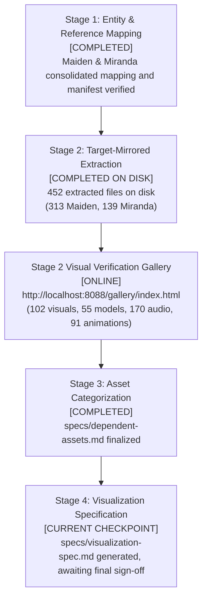

# Asset extraction roadmap and progress tracker: Maiden and Miranda

Target: `Goddess of Victory: NIKKE` (PC Client Build 578825, Version 153.6.10)  
Consolidated scope: Maiden (`c181`, `c183`) and Miranda (`c032`)  
Workspace: `workspace/nikke-maiden/`

---

## 1. Operating principles and scope boundaries

1. **Consolidated character scope:** Scope covers Maiden (`c181` Base SSR, `c183` Ice Rose SSR) and Miranda (`c032` Base SSR and Cheerleader costume). Other characters in the client are excluded.
2. **Audio constraints:** Character voice tracks are strictly restricted to Japanese audio voiced by Horie Yui (堀江由衣). Non-Japanese tracks (English, Korean) are documented out of scope.
3. **Co-voiced boundaries:** Horie Yui voices Maiden and Miranda. All other characters voiced by Horie Yui or other actors are outside this scope. Brid (`c070`), previously confused with Miranda in earlier preliminary notes, is confirmed to be an AZX squad character voiced by Ishizuka Sayori and is excluded.
4. **Favorite item distinction:** Miranda features an active Favorite Item system (`FavoriteItemScene_c032_00`, `favoriteitem_c032_00`), expanding her footprint beyond standard characters. Maiden does not possess a Favorite Item.
5. **Non-destructive operations:** Client files remain read-only. All outputs reside under `workspace/nikke-maiden/`. Automated git commits are prohibited.

---

## 2. Domain progress ledger

### 2.1 Maiden asset ledger (`c181` and `c183`)

| Domain | Total mapped | Extracted on disk | Status | Verification evidence |
|:---|:---|:---|:---|:---|
| **Live2D / Spine Standing Puppets** | 4 skins (12 files) | 12 files | Extracted | `assets/spine/standing/` (`c181_00`, `c181_01`, `c181_02`, `c183_00`) |
| **Live2D / Spine Combat Puppets** | 8 postures (24 files) | 24 files | Extracted | `assets/spine/combat/` (Aim and Cover for all 4 skins) |
| **3D SD Chibi Models & Meshes** | 8 meshes + broom (9 files) | 9 OBJ files | Extracted | `assets/models/sd/` (bodies, weapons, broom) |
| **3D SD Textures & Materials** | 12 textures | 12 PNG files | Extracted | `assets/models/sd/` (textures resolved from chunk containers) |
| **3D SD Skeletons & Rigs** | 4 avatars | 4 avatar structures | Extracted | Structure cataloged in `specs/mapping.md` |
| **3D SD Action Animations** | 61 `.anim` clips | 61 `.anim` files | Extracted | `assets/animations/` (aim, fire, cover, talk, run for `c181` and `c183`) |
| **Full Card Splash Illustrations** | 4 HD cards | 4 PNG files | Extracted | `assets/textures/full_cards/` (1024x1024) |
| **UI Portraits & Mini Icons** | 13 icons/badges | 13 PNG files | Extracted | `assets/textures/c181/` and `assets/textures/c183/` |
| **Field NPC Sprites** | 5 sprites | 5 PNG files | Extracted | `assets/textures/field_npc/` (Summer event chibi NPC) |
| **Japanese Voice Bank (Horie Yui)** | 112 tracks | 112 WAV files | Extracted | `assets/audio/ja/c181/` (60) and `c183/` (52) |
| **Combat Sound FX** | 7 cues | 7 WAV files | Extracted | `assets/audio/sfx/c183/` (reload, skill actions) |
| **Combat VFX Particle Textures & Meshes** | 24 constituent assets | 21 PNG + 3 OBJ | Extracted | `assets/vfx/` (Skill 1/2, Burst, Ice Rose buff) |
| **Burst Cutscenes** | 3 cutscene frames + 2 community videos | 3 PNG + 2 MP4 + 2 thumb PNG | Extracted & Supplemented | `assets/cutscenes/` & `assets/videos/` (Base & Ice Rose videos marked third-party) |
| **Scenario Backgrounds** | 2 illustrations | 2 PNG files | Extracted | `assets/textures/backgrounds/` (`ui_event_bg_acpufreeze.png`, `ui_event_bg_phantomthiefvsdetective.png`) |
| **Dialogue Vault** | 1,303 lines | 1,303 lines in JSON | Extracted | `assets/text/maiden_dialogue_vault.json` |

---

### 2.2 Miranda asset ledger (`c032`)

| Domain | Total mapped | Extracted on disk | Status | Source container and mapping reference |
|:---|:---|:---|:---|:---|
| **Live2D / Spine Standing Puppets** | 2 skins (6 files) | 6 files | Extracted | `assets/spine/standing/c032/` (`c032_00`, `c032_01`) |
| **Live2D / Spine Combat Puppets** | 4 postures (12 files) | 12 files | Extracted | `assets/spine/combat/c032/` (Aim & Cover for `00` and `01`) |
| **Spine Favorite Item Puppet** | 1 puppet (3 files) | 3 files | Extracted | `assets/spine/favoriteitem/c032/00/` (`favoriteitem_c032_00`) |
| **Interactive Favorite Item Scene** | 1 scene rig (12 files) | 12 files | Extracted | `assets/spine/favoriteitem_scene/c032/` (`FavoriteItemScene_c032_00`) |
| **3D SD Chibi Models & Meshes** | 2 models + weapons (9 files) | 9 files | Extracted | `assets/models/sd/c032_00/` and `c032_01/` |
| **3D SD Action Animations** | 30 `.anim` clips | 30 files | Extracted | `assets/animations/c032/` (15 for `c032_00`, 15 for `c032_01`) |
| **Full Card Splash Illustrations** | 2 HD cards | 2 PNG files | Extracted | `assets/textures/full_cards/` (`c032_00.png`, `c032_01.png`) |
| **UI Portraits & Mini Icons** | 6 icons/badges | 6 PNG files | Extracted | `assets/textures/c032/` (mini cards, square icons, burst icon, badge) |
| **Japanese Voice Bank (Horie Yui)** | 39 tracks (38 voice + 1 titlecall) | 39 WAV files | Extracted | `assets/audio/ja/c032/` (38 dialogue/affinity/battle + 1 titlecall) |
| **Action & Skill AudioClips** | 12 cues | 12 WAV files | Extracted | `assets/audio/sfx/c032/` (reload, expression, favorite item audio) |
| **Burst Cutscenes** | 1 Spine Live2D cutscene (3 files) | 3 files | Extracted | `assets/cutscenes/c032/` (`c032_00_skillcut`: skel, atlas, 2048x2048 PNG) |
| **Dialogue Vault** | 1,212 localized lines | 1 JSON vault | Extracted | `assets/text/miranda_dialogue_vault.json` |

---

### 2.3 Consolidated asset comparison: Maiden versus Miranda

| Asset Category | Maiden (`c181`, `c183`) | Miranda (`c032`) | Delta & Coverage Notes |
|:---|:---|:---|:---|
| **Skins / Costumes** | 4 skins (`00`, `01`, `02`, `c183_00`) | 2 skins (`00` Base, `01` Cheerleader) | Complete skin coverage for both characters |
| **Spine Standing Puppets** | 4 puppets (12 files) | 2 puppets (6 files) | High-definition Spine puppets on disk |
| **Spine Combat Puppets** | 8 puppets (24 files) | 4 puppets (12 files) | Full battle stance coverage (Aim & Cover per skin) |
| **Favorite Item Puppet** | None | 1 puppet (3 files) | Miranda exclusive asset type |
| **Favorite Item Scene** | None | 1 Live2D scene (12 files) | Miranda exclusive asset type |
| **3D SD Chibi Models** | 4 avatars + weapons + broom (9 files) | 2 avatars + signature weapons (9 files) | Complete chibi model coverage |
| **3D SD Action Animations** | 61 `.anim` clips | 30 `.anim` clips | Aim, fire, cover, idle, reload, run, talk clips |
| **Full Splash Cards** | 4 HD cards | 2 HD cards | High-resolution vertical splash illustrations |
| **UI Icons & Portraits** | 13 icons | 6 icons | Avatars, portraits, burst skill icons, badges |
| **Field NPC Sprites** | 5 sprites (Summer event) | None | Maiden exclusive event variant |
| **Japanese Voice Tracks** | 112 tracks | 39 tracks (38 dialogue + 1 titlecall) | Horie Yui voice tracks extracted for both |
| **Combat & Action SFX** | 7 cues | 12 cues | Skill actions, reloads, and favorite item cues |
| **Combat VFX Particles** | 24 constituent files | None | Maiden exclusive extracted VFX systems |
| **Burst Cutscenes** | 3 texture frames | 1 compound Live2D Spine cutscene | Miranda includes animated Spine cutscene |
| **Dialogue Lines** | 1,303 lines | 1,212 lines | Localized script text compiled in JSON vaults |

---

## 3. Four-stage pipeline tracker

### Stage 1: Entity and reference mapping
- Status: **Complete**
- Deliverables:
  - `specs/mapping.md`: Consolidated identity registries, catalog locations, FastCDC chunk mappings, negative boundaries, and confidence ladders.
  - `meta/manifest.json`: 566 total records covering Maiden and Miranda.
  - `meta/state.json`: Consolidated state tracking confidence metrics and pipeline boundaries.

### Stage 2: Target-mirrored extraction
- Status: **Completed on disk** (452 extracted files on disk)
- Maiden status: Complete (313 extracted assets on disk).
- Miranda status: Complete (139 extracted assets on disk).
- Gallery status: Online at `http://localhost:8088/gallery/index.html` displaying 104 visual assets (including 2 community third-party video cutscenes), 55 models, 170 audio tracks, 91 animations, and an external audit notice card linking `https://nikke-db.pages.dev/gallery`.

### Stage 3: Asset categorization
- Status: **Complete**
- Deliverable: `specs/dependent-assets.md`
- Scope: Pre-organization directory snapshot, provenance ledger (226 standalone files), and compound cluster definitions (226 compound files across Spine puppets, Favorite Item scenes, 3D SD chibi setups, action animations, and VFX particle systems).

### Stage 4: Visualization specification
- Status: **Current Checkpoint (Generated on disk, awaiting final sign-off)**
- Deliverable: `specs/visualization-spec.md`
- Scope: Runtime blueprints, Spine 4.1.20 binary configuration, procedural aiming tracking, Cinemachine 2D virtual camera parameters, and Three.js cel-shading toon rim shader formulations (`SDToon_Tex_RimDefault.png`).
