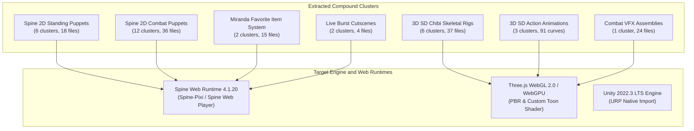
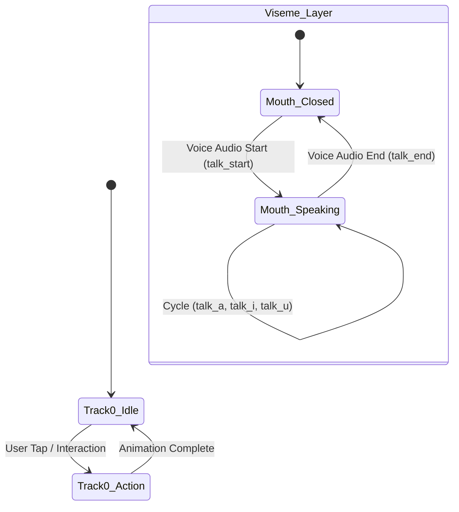
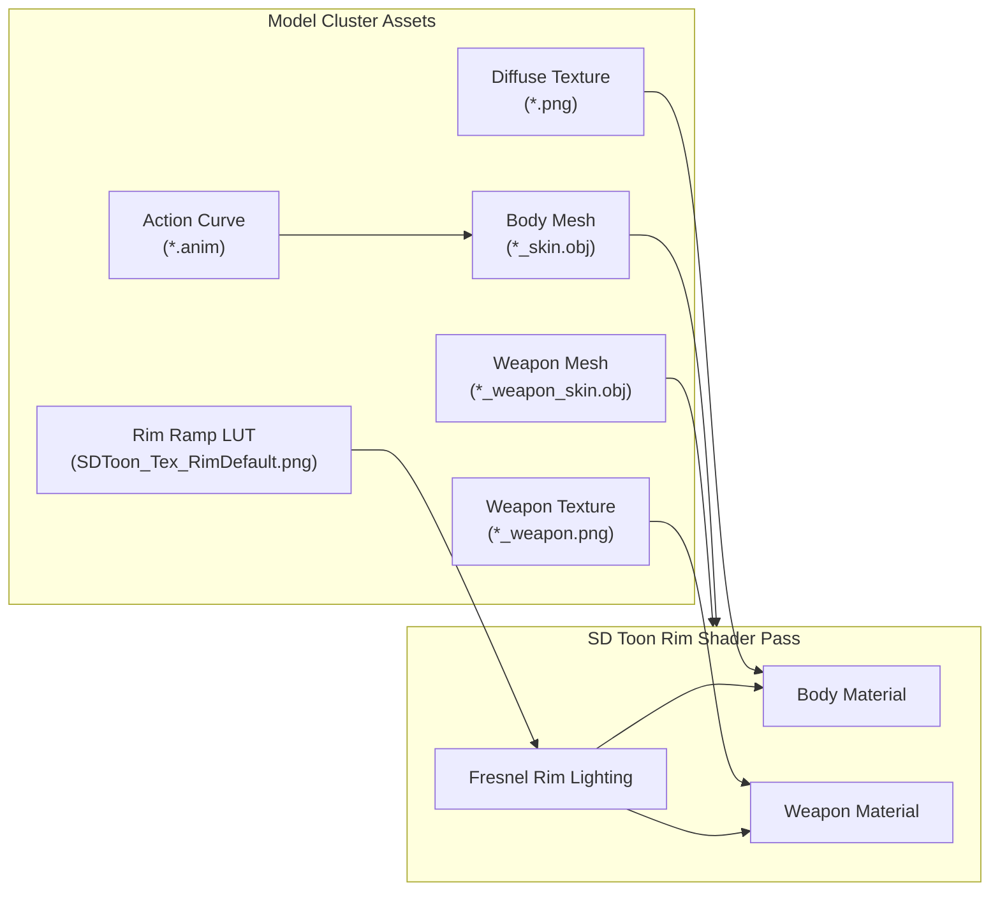
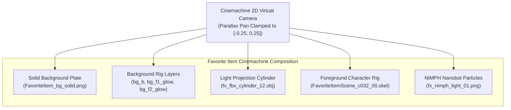

# Presentation and Visualization Specification: Maiden and Miranda

Target client: `Goddess of Victory: NIKKE` (PC Client Build 578825, Version 153.6.10)  
Entities: Maiden (`c181`, `c183`) and Miranda (`c032`)  
Pipeline stage: Stage 4 (Presentation and Visualization Specification)  
Workspace: `workspace/nikke-maiden/`

---

## 1. Architectural principles and runtime standards

This specification provides concrete technical blueprints for rendering, previewing, and integrating the 226 compound cluster assets categorized during Stage 3. It establishes exact binding graphs, shader mathematics, camera bounds, and runtime engine configurations.



### Core runtime standards
1. **Spine binary format version 4.1.20.** All 2D skeletal rigs are encoded in Spine 4.1 binary (`.skel`). Textures are exported with premultiplied alpha (`pma: true`) on 2048x2048 atlas pages. Runtimes must use `BlendMode.NORMAL` with premultiplied alpha or `ONE, ONE_MINUS_SRC_ALPHA` to prevent dark edge halos.
2. **Cel-shaded 3D SD chibi models.** Character and weapon geometries use Wavefront OBJ format with vertex normals, UV channels, and face groups. Shading requires a custom toon rim shader driven by the extracted 256x2 lookup ramp (`SDToon_Tex_RimDefault.png`).
3. **Dual-layer Cinemachine scene architecture.** Miranda's Favorite Item interactive set combines a multi-layered Spine rig, a 12-sided light projection cylinder, dynamic UV scrolling textures, and a 2D virtual camera with clamped parallax tracking.

---

## 2. 2D Live2D Spine runtime specification

### 2.1 Standing and lobby puppets (6 clusters)

Standing puppets drive lobby interactions, bond inspection screens, and narrative visual novel dialogue sequences.

| Entity and costume | Preserved directory path | Atlas canvas | Texture scale factor | Constituent files |
| :--- | :--- | :--- | :--- | :--- |
| **Maiden Base (`c181_00`)** | `assets/spine/standing/c181/00/` | 2048x2048 | 0.85 | `c181_00.skel`, `c181_00.atlas`, `c181_00.png` |
| **Maiden Nurse (`c181_01`)** | `assets/spine/standing/c181/01/` | 2048x2048 | 0.85 | `c181_01.skel`, `c181_01.atlas`, `c181_01.png` |
| **Maiden Summer (`c181_02`)** | `assets/spine/standing/c181/02/` | 2048x2048 | 0.85 | `c181_02.skel`, `c181_02.atlas`, `c181_02.png` |
| **Maiden Ice Rose (`c183_00`)** | `assets/spine/standing/c183/00/` | 2048x2048 | 0.85 | `c183_00.skel`, `c183_00.atlas`, `c183_00.png` |
| **Miranda Base (`c032_00`)** | `assets/spine/standing/c032/00/` | 2048x2048 | 1.34 | `c032_00.skel`, `c032_00.atlas`, `c032_00.png` |
| **Miranda Cheerleader (`c032_01`)** | `assets/spine/standing/c032/01/` | 2048x2048 | 1.34 | `c032_01.skel`, `c032_01.atlas`, `c032_01.png` |

#### Animation track layering and state machine
Standing rigs utilize two concurrent animation tracks in Spine runtimes:
- **Track 0 (Base layer):** Loops ambient pose `idle`. Drives subtle chest breathing, cloth swaying, and eye blinking. Triggers `action` on user touch input, playing a non-looping emotional reaction before returning to `idle`.
- **Track 1 (Viseme dialogue layer):** Plays additive mouth shape animations during dialogue line playback:
  - `talk_start`: Initial transition into open-mouth speaking pose.
  - `talk_a`, `talk_i`, `talk_u`: Localized vowel viseme animations cycled in sync with voice audio envelopes.
  - `talk_close`, `talk_end`: Return to closed-mouth resting state.
- **Blending configuration:** Set track mix duration to `0.2s` between `idle` and `action` to maintain smooth transitions.



---

### 2.2 Combat puppets (12 clusters)

Each character form splits into two distinct Spine combat assemblies: Aiming posture (active engagement) and Cover posture (tactical cover/reload).

| Entity and costume | Aim posture directory | Cover posture directory | Canvas format |
| :--- | :--- | :--- | :--- |
| **Maiden Base (`c181_00`)** | `assets/spine/combat/c181/00/aim/` | `assets/spine/combat/c181/00/cover/` | 2048x2048 PMA PNG |
| **Maiden Nurse (`c181_01`)** | `assets/spine/combat/c181/01/aim/` | `assets/spine/combat/c181/01/cover/` | 2048x2048 PMA PNG |
| **Maiden Summer (`c181_02`)** | `assets/spine/combat/c181/02/aim/` | `assets/spine/combat/c181/02/cover/` | 2048x2048 PMA PNG |
| **Maiden Ice Rose (`c183_00`)** | `assets/spine/combat/c183/00/aim/` | `assets/spine/combat/c183/00/cover/` | 2048x2048 PMA PNG |
| **Miranda Base (`c032_00`)** | `assets/spine/combat/c032/00/aim/` | `assets/spine/combat/c032/00/cover/` | 2048x2048 PMA PNG |
| **Miranda Cheerleader (`c032_01`)** | `assets/spine/combat/c032/01/aim/` | `assets/spine/combat/c032/01/cover/` | 2048x2048 PMA PNG |

#### Procedural aiming and bone tracking
- **Aiming reticle constraint:** Aim rigs contain target tracking bones (`aim_x`, `aim_y`). Runtime scripts map normalized screen reticle coordinates `[-1.0, 1.0]` directly to bone translation offsets, causing the character's head, weapon barrel, and torso to dynamically track the target reticle during `aim_idle` and `aim_fire`.
- **Secondary physics tracks:** Gunfire triggers `aim_fire`, while physics bones automatically apply hair bounce (`aim_fire_hair`) and hip recoil (`aim_fire_hip`).
- **Cover state transitions:** Switching between aim and cover triggers transition clips:
  - Aim to Cover: Play clip `to_cover` (duration ~0.15s), then swap active Spine instance to Cover rig playing `cover_idle`.
  - Cover to Aim: Play clip `to_aim` (duration ~0.15s), then swap active Spine instance to Aim rig playing `aim_idle`.
  - Tactical reload: Trigger `cover_reload` on the Cover rig while synchronizing weapon reload audio (`assets/audio/sfx/`).

---

### 2.3 Miranda Favorite Item interactive desktop puppet

The Favorite Item standalone puppet (`favoriteitem_c032_00`) represents an interactive desk miniature with coordinate tracking bones.

- **Directory:** `assets/spine/favoriteitem/c032/00/`
- **Files:** `favoriteitem_c032_00.skel`, `favoriteitem_c032_00.atlas`, `favoriteitem_c032_00.png` (2048x2048)
- **Interactive bone hierarchy:**
  - `ctr_x`, `ctr_x_rev`: Horizontal tracking axis and inverted counter-balance bone.
  - `ctr_y`, `ctr_y_rev`: Vertical tracking axis and inverted counter-balance bone.
  - `x_control`, `y_control`: Input driver bones bound to mouse cursor position or touch coordinates.
  - `flag_ctr`, `flag_ctr_rev`: Dynamic flag and pennant cloth wave drivers.
- **Runtime implementation:** In Spine-Pixi, attach a pointer move listener to update `skeleton.findBone('x_control').x` and `skeleton.findBone('y_control').y`. Normalized input range `[-100, 100]` maps to 15 degrees of procedural tilt.

---

### 2.4 Burst cutscenes and animated sequences

1. **Miranda Animated Live2D Cutscene (`c032_00_skillcut`):**
   - **Directory:** `assets/cutscenes/c032/`
   - **Files:** `c032_00_skillcut.skel`, `c032_00_skillcut.atlas`, `c032_00_skillcut.png` (2048x2048, scale 0.92)
   - **Animation track:** `idle`. Contains articulated bones for left/right suspenders (`L_suspender`, `R_suspender`), pupils (`L_eye_pupil`), eyelashes, and hair fringe.
   - **Camera animation:** The cutscene runs across a 2048x2048 canvas. The camera applies a diagonal zoom punch from normalized scale 1.0 to 1.25 over the first 0.35s of playback, letterboxed to a 16:9 viewport.
2. **Maiden Live Wallpaper Cutscene Thumbnail (`EventScene_c181_cutscene_mi`):**
   - **Directory:** `assets/cutscenes/c181/`
   - **File:** `EventScene_c181_cutscene_mi.png` (256x512, 1:2 vertical aspect ratio)
   - **Presentation:** Rendered as a vertical framed card in UI selection dialogs. Remote video cutscenes resolved via CDN streams are cataloged in `specs/on-demand-cdns.md`.
3. **Maiden Burst Cutscene Video Captures (Third-Party Community Provenance):**
   - **Directory:** `assets/videos/`
   - **Files:** `c181_00_burst_cutscene_community.mp4` (888x1920, 844,607 bytes) with thumbnail `c181_00_burst_cutscene_community_thumb.png`, and `c183_00_burst_cutscene_community.mp4` (1920x1080, 10,656,482 bytes) with thumbnail `c183_00_burst_cutscene_community_thumb.png`.
   - **Provenance:** Third-party clean community screen recordings supplementing the missing offline Addressables bundles (`spotskillcutscene_assets_c181_00_cut_scene_*.bundle`). Tagged with `[Third-Party]` badges in the confirmation gallery for in-modal video playback.

---

## 3. 3D SD chibi character and weapon specification

Six complete 3D SD model clusters are extracted under `assets/models/sd/`.



### 3.1 Model cluster bindings

| Cluster identifier | Character geometry | Weapon geometry | Diffuse texture maps | Bone avatar metadata |
| :--- | :--- | :--- | :--- | :--- |
| **Maiden Base (`c181_00`)** | `c181_00_skin.obj` (1,248 vertices) | `c181_00_weapon_skin.obj` | `c181_00.png` (512x512), `c181_00_weapon.png` (512x512) | `c181_00Avatar.json` (84 joints) |
| **Maiden Nurse (`c181_01`)** | `c181_01_skin.obj` (1,180 vertices) | `c181_01_weapon_skin.obj` | `c181_01.png` (512x512), `c181_00_weapon.png` (512x512) | `c181_01Avatar.json` (82 joints) |
| **Maiden Summer (`c181_02`)** | `c181_02_skin.obj` (1,324 vertices) | `c181_02 _weapon_skin.obj` | `c181_02.png` (512x512), `c181_02_weapon.png` (256x256) | `c181_02Avatar.json` (82 joints) |
| **Maiden Ice Rose (`c183_00`)** | `c183_00_skin.obj` (1,496 vertices) | `c183_00_weapon_skin.obj`, `c183_00_broom.obj` | `c183_00.png` (512x512), `c183_00_weapon.png` (2048x2048) | `c183_00Avatar.json` (84 joints) |
| **Miranda Base (`c032_00`)** | `c032_00_skin.obj` (1,154 vertices) | `c032_00_weapon_skin.obj` | `c032_00.png` (512x512), `c032_00_weapon.png` (256x256) | `c032_00Avatar.json` (78 joints) |
| **Miranda Cheerleader (`c032_01`)** | `c032_01_skin.obj` (1,310 vertices) | `c032_01_weapon_skin.obj` | `c032_01.png` (512x512), `c032_01_weapon.png` (256x256) | `c032_01Avatar.json` (78 joints) |

All six clusters share the universal toon rim lighting lookup ramp located at `assets/models/sd/<cluster>/SDToon_Tex_RimDefault.png`.

---

### 3.2 SD Toon Rim shader formulation

In the game client's custom Unity shader (`SDToonShader`), character lighting combines flat cel diffuse bands with a view-dependent Fresnel rim light sampled from `SDToon_Tex_RimDefault.png`.

#### Texture specifications
- `SDToon_Tex_RimDefault.png`: 256x2 RGBA texture.
- The ramp is sampled along the U axis using a view-space Fresnel term:
  $$u = 1.0 - \max(\vec{N} \cdot \vec{V}, 0.0)$$
  $$v = 0.5$$
- The sampled color provides the RGB rim glow, while alpha modulates rim opacity.

#### Fragment shader calculation
In a Three.js `ShaderMaterial` or GLSL fragment shader, evaluate:

```glsl
// Uniforms
uniform sampler2D u_diffuse_map;
uniform sampler2D u_rim_lut;
uniform vec3 u_light_dir;
uniform vec3 u_rim_tint;
uniform float u_rim_intensity;

// Varyings from vertex shader
varying vec2 v_uv;
varying vec3 v_normal;
varying vec3 v_view_dir;

void main() {
    vec4 diffuse_tex = texture2D(u_diffuse_map, v_uv);
    if (diffuse_tex.a < 0.5) discard;

    vec3 N = normalize(v_normal);
    vec3 V = normalize(v_view_dir);
    vec3 L = normalize(u_light_dir);

    // Cel diffuse step
    float NdotL = dot(N, L);
    float cel_light = smoothstep(0.0, 0.05, NdotL) * 0.4 + 0.6;

    // View-dependent Fresnel rim lookup
    float NdotV = clamp(dot(N, V), 0.0, 1.0);
    float fresnel = 1.0 - NdotV;
    vec4 rim_sample = texture2D(u_rim_lut, vec2(fresnel, 0.5));

    // Combine diffuse and additive rim glow
    vec3 final_color = diffuse_tex.rgb * cel_light + (rim_sample.rgb * u_rim_tint * u_rim_intensity);
    gl_FragColor = vec4(final_color, diffuse_tex.a);
}
```

---

### 3.3 3D SD action animation sets (91 clips)

The 91 serialized Unity `.anim` clips in `assets/animations/` define skeletal curve tables:
- `assets/animations/c181/` (45 clips): Base, Nurse, and Summer animation curves.
- `assets/animations/c183/` (16 clips): Ice Rose heavy weapon and broom-riding curves.
- `assets/animations/c032/` (30 clips): Miranda Base and Cheerleader animation curves (15 clips each).

#### Clip state classification
1. **Locomotion:** `idle` (60 frames loop), `walk` (30 frames loop), `run` (24 frames loop).
2. **Combat tactical:** `aim_start` (10 frames), `aim_idle` (30 frames loop), `shot` (12 frames recoil), `aim_end` (10 frames), `cover_idle` (30 frames loop), `cover_shot` (15 frames), `cover_reload` (45 frames cycle).
3. **Reactions and emotes:** `stun` (20 frames loop), `death` (40 frames non-looping), `talk_idle` (30 frames), `talk_1` (45 frames), `talk_2` (45 frames).

When importing into Three.js or Unity, bind the weapon mesh to bone socket `Bip001 R Hand` on the character skeleton so weapon meshes track arm animations automatically.

---

## 4. Interactive Cinemachine scene specification (`FavoriteItemScene_c032_00`)

Miranda's Favorite Item scene is a compound multi-component set located in `assets/spine/favoriteitem_scene/c032/`.



### 4.1 Asset inventory and role assignment

| Asset file | File type | Resolution / Vertices | Role in scene composition |
| :--- | :--- | :--- | :--- |
| `FavoriteItemScene_c032_00.skel` | Spine 4.1.20 Binary | 413,489 bytes | Master dual-layer Spine rig (character and furniture) |
| `FavoriteItemScene_c032_00.atlas` | Spine Atlas | 4,969 bytes | Atlas layout mapping 18 sprite components |
| `FavoriteItemScene_c032_00.png` | RGBA Texture | 2048x2048 | Main diffuse atlas containing character, desk, and lighting |
| `fx_fbx_cylinder_12.obj` | 3D OBJ Geometry | 19 vertices, 12 faces | 12-sided light projection cylinder for volumetric halo |
| `FavoriteItem_bg_solid.png` | Solid Texture | 181 bytes | Dark neutral vignette background plate |
| `fx_c032_FavoriteItemScene_atlas.png` | Texture Atlas | 133,488 bytes | Particle emitter texture for desk terminal sparks |
| `fx_c032_FavoriteItemScene_uv.png` | UV Distortion Map | 5,675 bytes | Scanline distortion map for terminal hologram |
| `fx_c032_FavoriteItemScene_uv1.png` | UV Distortion Map | 7,698 bytes | Secondary vertical flicker map for holographic text |
| `fx_nimph_light_01.png` | Particle Sprite | 72,702 bytes | Glowing NIMPH particle billboard sprite |
| `fx_jh_pattern_01_color.png` | Texture Map | 59,994 bytes | Radial floor flare texture |
| `fx_pattern_03_blur.png` | Texture Map | 52,189 bytes | Ambient volumetric bokeh bloom sprite |
| `fx_gra_02.png` | Gradient Map | 1,101 bytes | Linear vertical falloff ramp for desk shadow |
| `fx_npc_c5010_summer_item_gun_atlas_dis.png` | Texture Map | 14,595 bytes | Holographic weapon projection sprite |

### 4.2 Cinemachine 2D virtual camera parameters
In the game client, this scene is rendered with Unity Cinemachine 2D:
- **Projection:** Orthographic, size 5.4 units.
- **Aspect ratio:** 16:9 responsive display with vertical letterboxing on wider displays.
- **Parallax bounding box:**
  - Horizontal camera offset clamped to `X in [-0.25, 0.25]`.
  - Vertical camera offset clamped to `Y in [-0.10, 0.10]`.
  - Background layer depth factor: `0.35` (moves 35% of camera delta).
  - Character foreground depth factor: `1.00` (anchored to camera focal plane).
  - Nanobot particle depth factor: `1.20` (foreground parallax shift).

---

## 5. Combat VFX particle system specification (Maiden exclusive)

The 24 assets in `assets/vfx/` drive Maiden's electric skill particles, shockwave rings, and Ice Rose seasonal frost shaders.

| Asset path | Format | Dimensions | Shader blend mode | Role |
| :--- | :--- | :--- | :--- | :--- |
| `assets/vfx/fx_c181_sk1_symbol_01.png` | Texture | 256x256 | Additive (`ONE, ONE`) | Skill 1 electric skull insignia billboard |
| `assets/vfx/fx_c181_sk2_altas_04.png` | Atlas | 1024x1024 | Additive (`ONE, ONE`) | Skill 2 shockwave arc sprite sheet |
| `assets/vfx/fx_c181_skill2_fbx_01.obj` | 3D Mesh | 84 vertices | Geometry | Truncated cone geometry for electric shockwave flare |
| `assets/vfx/fx_c181_ult_atlas_04.png` | Atlas | 512x512 | Additive (`ONE, ONE`) | Burst skill lightning bolt sequence |
| `assets/vfx/fx_c181_ult_hit_altas_01.png` | Atlas | 1024x1024 | Additive (`ONE, ONE`) | Target hit spark burst atlas |
| `assets/vfx/fx_c183_sk1_altas.png` | Atlas | 512x512 | Additive (`ONE, ONE`) | Ice Rose frost snowflake burst |
| `assets/vfx/fx_c183_sk2_hit.png` | Atlas | 1024x1024 | Additive (`ONE, ONE`) | Ice Rose ice spike impact ring |
| `assets/vfx/fx_fbx_cylinder_15.obj` | 3D Mesh | 32 vertices | Geometry | Cylinder mesh for rising electrical aura |
| `assets/vfx/fx_common_triangle_particle.obj` | 3D Mesh | 6 vertices | Geometry | Debris particle quad |
| `assets/vfx/fx_hs_flowmap_01.png` | Flow Map | 512x512 | Linear Data | UV flow map driving turbulent air distortion |
| `assets/vfx/fx_jh_ring_ani_07.png` | Sprite Sheet | 512x512 | Additive (`ONE, ONE`) | 4x4 animated shockwave ring frames |
| `assets/vfx/fx_lens_01.png` | Sprite | 256x256 | Additive (`ONE, ONE`) | Central lens flare stinger |
| `assets/vfx/fx_sb_smoke_06.png` | Texture | 512x512 | Normal (`SRC_ALPHA, ONE_MINUS_SRC_ALPHA`) | Dissipating dark gun smoke |
| `assets/vfx/fx_story_event_neverland_pattern_02.png` | Pattern | 1024x1024 | Additive (`ONE, ONE`) | Winter Neverland swirling blizzard pattern |
| `assets/vfx/fx_story_event_neverland_smoke_01.png` | Texture | 512x512 | Additive (`ONE, ONE`) | Sub-zero breath condensation and cold mist |

#### UV flow map shader formulation
Distortion effects (shockwaves and blizzard turbulence) evaluate:
```glsl
vec2 flow_vector = texture2D(u_flowmap, v_uv + vec2(u_time * 0.1, 0.0)).rg * 2.0 - 1.0;
vec2 distorted_uv = v_uv + flow_vector * u_distortion_strength;
vec4 final_particle = texture2D(u_particle_texture, distorted_uv);
```

---

## 6. Standalone media presentation transforms

Category A standalone media require specific presentation framing and viewport transforms to match original client display.

### 6.1 Full character splash cards (`assets/textures/full_cards/`)
- **Native resolution:** 1024x1024 square PNG files.
- **In-game framing:** Vertical card container with 9:16 or 3:4 aspect ratio.
- **Anchor point:** Horizontal center (X: 50%), vertical base anchor (Y: 88%).
- **Alpha gradient:** In the game client UI, character cards apply a linear alpha falloff over the bottom 15% of the frame ($y \in [0.0, 0.15]$) to blend into dark card footer frames.

### 6.2 Scenario backgrounds (`assets/textures/backgrounds/`)
- `ui_event_bg_acpufreeze.png` (1024x512) and `ui_event_bg_phantomthiefvsdetective.png` (1024x512).
- Native aspect ratio is 2:1. When displayed on 16:9 screens, crop 6% from top and bottom margins to fit full-bleed widescreen layouts.

### 6.3 Summer event field NPC sprites (`assets/textures/field_npc/`)
- `c181_02.png` (512x512) paired with `febg_tropical_003_ani_01.png` (1024x1024) and `fx_sb_fieldmap_flowmap_03.png` (256x256).
- Renders tropical water ripples beneath Maiden's summer chibi sprite using dynamic UV scrolling over the flow map.

---

## 7. Recommended runtime blueprints and tech stack

For developers building web viewers or interactive applications from these extracted assets:

| Asset class | Recommended web runtime | Standalone engine runtime |
| :--- | :--- | :--- |
| **Spine 2D Puppets (Standing & Combat)** | **PixiJS v7** + `@pixi-spine/runtime-4.1` (or Spine Web Player 4.1) | Unity 2022.3 LTS with official Spine-Unity 4.1 runtime package |
| **Miranda Favorite Item Scene** | PixiJS multi-container scene with HTML5 pointer tracking | Unity 2022.3 LTS with Cinemachine 2D virtual camera |
| **3D SD Chibi Characters & Weapons** | **Three.js r160+** (WebGL 2.0) with custom `ShaderMaterial` for toon rim | Godot 4.x (Standard Toon Shader) or Unity Universal Render Pipeline (URP) |
| **3D SD Action Animations** | Three.js `AnimationMixer` parsing deserialized curve tables | Unity native `Animator` with `Avatar` humanoid mapping |
| **Combat VFX Particles** | Three.js `Points` or mesh instancing with additive materials | Unity Shuriken Particle System or Visual Effect Graph (VFX Graph) |
| **Audio Voice Bank & SFX** | Howler.js (Web Audio API) with stereo channel playback | FMOD Studio or native Unity AudioSource |
